<div align="center">



# operational-problem-solver

**Parallel worker teams · a consensus stability gate · an ELO tournament that ships the single best solution.**

[](LICENSE) &nbsp; &nbsp;[](https://github.com/NAJEMWEHBE/operational-problem-solver/actions/workflows/ci.yml) &nbsp;

[**🌐 Live page**](https://najemwehbe.github.io/operational-problem-solver/) &nbsp;·&nbsp; [Architecture](docs/ARCHITECTURE.md) &nbsp;·&nbsp; [Skill](.claude/skills/problem-solver/SKILL.md)

</div>

A multi-team agentic engine for Claude Code. It spins up **parallel worker teams**
to solve a technical problem, gates their output on a **consensus stability
threshold**, then runs an **ELO tournament** to rank the surviving solutions
head-to-head and ship the single best one.

```
                 [ Central Orchestrator ]
                /          |             \
   [ Intelligence ]   [ Execution ]   [ Quality Assurance ]
      Crow x2            Finch x4       Consensus + ELO
   context manifest   N solutions     gate -> tournament -> winner
```

Two halves, one repo:
- **A Claude Code skill** (`.claude/skills/problem-solver/`) — the in-session
  orchestration layer.
- **A standalone Python engine** (`ops-solve`) — the real work: parallel fan-out
  over the Anthropic Messages API, linters/tests via subprocess, and a
  deterministic ELO tournament.

---

## Has this been done before?

The **pieces** are well-established; this **exact packaged combination** for
Claude Code was not on the shelf when this was built. Honest prior art:

- **Parallel Claude-agent orchestration already exists** —
  [claude-flow](https://github.com/ruvnet/claude-flow),
  [claude_code_agent_farm](https://github.com/Dicklesworthstone/claude_code_agent_farm),
  [swarms](https://github.com/kyegomez/swarms), and the native Claude Code Task /
  Workflow tools. None ship a consensus-gated ELO tournament over competing code
  solutions as a packaged skill.
- **The algorithms are proven research** —
  [Self-Consistency](https://arxiv.org/abs/2203.11171),
  [AlphaCode (generate → filter → cluster → rank)](https://arxiv.org/abs/2203.07814),
  [CodeT](https://arxiv.org/abs/2207.10397),
  [LLM-as-judge / MT-Bench](https://arxiv.org/abs/2306.05685),
  [Chatbot Arena (Bradley-Terry / Elo)](https://arxiv.org/abs/2403.04132),
  [Mixture-of-Agents](https://arxiv.org/abs/2406.04692).
- **ELO-ranking of agents/pipelines exists as tooling** —
  [RAGElo](https://github.com/zetaalphavector/RAGElo),
  [CodeElo](https://github.com/QwenLM/CodeElo),
  [llm-council](https://github.com/karpathy/llm-council). The closest end-to-end
  analog is [AlphaEvolve](https://deepmind.google/blog/alphaevolve-a-gemini-powered-coding-agent-for-designing-advanced-algorithms/)
  (generate + evaluate + evolve) — but it is Gemini/Google and not packaged for Claude.

So this project is **novel as an integration, not as research.** It reuses
known-good ELO / Bradley-Terry math and the AlphaCode / LLM-as-judge patterns.

---

## ⚠️ Cost — this is not free

Each worker and the judge are **metered Claude API calls**. The default fan-out
is **18 calls per run**: 2 Intelligence + 4 Execution + 6 judge pairs x 2 orders
(each pair is judged both ways to cancel position bias). A consensus re-loop adds
4 more (22). 12 of the 18 go to the Opus judge, so the judge dominates the bill.
The CLI prints the expected count before it starts. Judge calls grow with
C(workers, 2) x rounds, so:

- `--cheap` runs workers on Haiku 4.5; the judge stays on Opus 4.8.
- Fewer `--workers` (3 workers: 3 pairs, 11 calls), fewer `--rounds`, `--reloops 0`.
- `--concurrency` caps calls in flight (default 8); lower it if you hit rate limits.
- Prompt caching is built in: all workers share one model + a cached Context
  Manifest prefix, and the judge caches the shared problem context across rounds.

The engine prints an **estimated USD cost** at the end of every run.

The offline test suite (`pytest`) exercises the ELO math, the consensus gate, and
the full orchestrator loop with a **mocked** model — **zero API spend.**

---

## Setup

```powershell
git clone https://github.com/NAJEMWEHBE/operational-problem-solver
cd operational-problem-solver
python -m venv .venv; .venv\Scripts\Activate.ps1      # Windows PowerShell
pip install -e .
Copy-Item .env.example .env                            # then edit: ANTHROPIC_API_KEY=sk-ant-...
pytest -q                                              # offline logic tests, no API spend
```

macOS / Linux: `source .venv/bin/activate` and `cp .env.example .env`.

---

## Usage

```bash
# Smallest real smoke test (cheap):
ops-solve "solve: write a Python is_prime(n) with a few tests" --workers 2 --cheap

# Gate consensus on real tests (EXECUTES the generated code — see Security):
ops-solve "solve: write a Python is_prime(n) with tests" --workers 4 --test-cmd "pytest -q {file}"

# Write the winning file somewhere:
ops-solve "solve: a CLI that reverses stdin" --out ./reverse.py
```

Options: `--workers/-w`, `--intel/-i`, `--rounds/-r`, `--reloops`, `--concurrency/-c`,
`--test-cmd`, `--out`, `--force` (let `--out` overwrite), `--cheap`, `--lang`,
`--debug` (full tracebacks). `ops-solve --help` lists them all.

**How `--test-cmd` runs.** The command runs once per worker, in a fresh private
folder outside your working directory (under `%LOCALAPPDATA%\ops-solve\test-runs\`
on Windows, `$XDG_CACHE_HOME` or `~/.cache/ops-solve/test-runs/` elsewhere) that
holds only a copy of the solution file (`solution.py`, `solution.js`, ...) and is
removed afterwards. Config and hook files of the project you run ops-solve in
(`pytest.ini`, `conftest.py`, ...) are therefore not picked up. `{file}` in the
command is replaced with the file name. pytest does not collect `solution.py` on
its own, so a bare `pytest -q` finds no tests (exit 5) and fails every worker:

- tests written inside the solution: `--test-cmd "pytest -q {file}"`
- your own tests: pass their absolute path, e.g.
  `--test-cmd "python -m pytest -q /abs/path/to/tests"`; `python -m` puts the
  current folder (the private one holding `solution.py`) on `sys.path`, so the
  tests can `import solution`.

Each run writes to `runs/<run-id>/`:
- `Finch-NN/` — each worker's isolated solution + notes
- `WINNER/` — the shipped solution
- `report.json` — manifest, evals, leaderboard, winner, token/cost summary

---

## Using the skill in Claude Code

Copy the skill into a project so Claude Code discovers it:

```
.claude/skills/problem-solver/SKILL.md
```

Then `/problem-solver` or say `solve: <problem>`. With the engine installed and a
key present, the skill shells out to `ops-solve` (deterministic ELO). Otherwise it
orchestrates subagents in-session with the Agent tool (ELO reasoned by the model,
less rigorous). See [SKILL.md](.claude/skills/problem-solver/SKILL.md).

---

## How it works

1. **Intelligence (Crow):** `env_probe` collects real facts (file tree, language,
   deps, available linters). Parallel Crows interpret them into one
   `ContextManifest`.
2. **Execution (Finch):** parallel isolated workers — same manifest, distinct
   strategy prompt — each emit a complete standalone solution into its own
   workspace.
3. **QA Layer 1 (Consensus):** syntax-check + lint + optional tests per artifact.
   If `< 50%` are stable, mutate prompts and re-loop Execution.
4. **QA Layer 2 (ELO):** survivors are judged pairwise by Opus; a standard ELO
   update (`K=32`, start `1000`) plus the objective scores produces a ranked
   leaderboard. The top entry is shipped.

See [docs/ARCHITECTURE.md](docs/ARCHITECTURE.md) for the data flow and formulas.

---

## Security

- Syntax checks (`ast.parse`) and linting (`ruff`) **do not execute** the
  generated code.
- `--test-cmd` **does** execute it (that is the point of a test gate). It is
  opt-in. Only use it on solutions you are willing to run; the engine runs the
  command in a private folder outside the working directory.
- The working directory may be a project you don't control, so ops-solve takes
  only plain data from it: the probe and the `.env` loader read regular files
  inside it (no links) with size limits; a `.env` there may set
  `ANTHROPIC_API_KEY` and `ANTHROPIC_LOG` but not the API endpoint
  (`ANTHROPIC_BASE_URL` comes only from your real environment); `ruff` (and, on
  Windows, `taskkill`) is started by absolute path; ruff writes no cache; and
  `--out` never writes through a link at the target path, nor out of the working
  directory through a linked folder.
- Arguments reach ops-solve exactly as typed on every OS (no `~`, `%VAR%` or
  wildcard expansion inside the program on Windows).
- Worker "isolation" means separate directories + no shared state + diversity
  prompts — **not** OS-level sandboxing.

## License

MIT — see [LICENSE](LICENSE).
